# Baton

[Watch the 90-second captioned demo](https://youtu.be/16P-i_Akzgk): a screenshot
walkthrough of stored c93 verification evidence — six checks passed, two failed,
and the release was blocked. It is not a fresh free-text planner demonstration.
[Video scope and provenance](docs/evidence/VIDEO_DEMO.md).

## Give the agent a goal

An engineer can see a merged pull request, a failed check and an old discussion,
yet still not know what to do next. The evidence is split across code, reviews,
test runs and work trackers. Baton exists to turn that scattered context into a
specific, reviewable next action, with the evidence and result kept together.

Baton turns a company goal into source-backed work: investigate the connected
evidence, propose a plan, choose the next action, and retain the actual result.
The current workspace uses public FalkorDB engineering records; the connected
Jira and Slack destinations belong to the operator, not FalkorDB's internal team.

Groq interprets the free-text goal, chooses graph tools, authors a variable plan
and selects its next graph-ready step. FalkorDB stores the plan dependencies,
evidence bindings, observations and revisions. The host validates permissions
and readbacks. Missing AI cannot produce a substitute semantic plan; missing or
stale graph evidence blocks action. The existing immutable verification runner
is one available capability. No arbitrary repository execution, source repair,
internal ownership inference or ten independently validated AI features is claimed.

The AI supplies the goal interpretation, evidence-seeking choices, proposed work
graph and outcome assessment. FalkorDB supplies the connected facts, persistent
episodes, plan dependencies and evidence bindings used to decide which actions
are eligible. Neither is an optional answer decoration. Deterministic checks
remain responsible for permissions and proof; model confidence never establishes
that an external action or a code check succeeded.

**Validation status:** local goal-agent and interface checks pass; fresh deployed
goal diversity and action proofs are still pending. The earlier completed c93
verification run is separate evidence of the bounded runner, not proof of the
new planner. [Interface and proof requirements](docs/GOAL_AGENT_CONTRACT.md) ·
[20 additional GitHub references and reuse decisions](docs/AI_NATIVE_REUSE.md).

## Graph-driven change verification

The bounded verification capability investigates [FalkorDB-py PR #212](https://github.com/FalkorDB/falkordb-py/pull/212): why must a synchronous serializer change also be checked through the async client? Source-proven calls and inheritance in FalkorDB determine the required sync/async regressions. Groq inspects typed graph tools; deterministic policy seals the executable plan.

An authenticated operator's **Investigate and verify** action starts an isolated GitHub Actions matrix against Python Redis client versions 8.0.0 and 8.1.0, preserves unchanged upstream source, and independently verifies the resulting artifacts. Both environments are required. Verified failing checks produce a blocked decision and an open evidence-backed remediation task in the operator's Jira project, plus a Slack report. Publication verification is separate from passing code checks.

This is verification of an existing merged change, with no source repair or upstream merge. Local feasibility and contract-test results are not evidence of a new deployed app run. The earlier Rust repair workflow remains available separately. [Architecture, exact scope and evidence boundaries](docs/CHANGE_VERIFICATION.md).

[Source publication boundary](docs/SOURCE_PUBLICATION.md) · [Third-party notices](docs/THIRD_PARTY_NOTICES.md). The public source mirror preserves genuine source history; private runner logs and credentials are not published with it.

## Separate historical Rust workflow

**Turn a public company issue into work you can verify.**

[Open the cloud workflow workbench](https://baton-workspace.vercel.app/#workflow-runner). An authenticated operator can start the approved FalkorDB issue profile: Groq investigates graph evidence, GitHub Actions runs real code checks in a fresh isolated Docker container, Groq may propose a bounded production edit after an observed failure, and the app independently verifies the outcome before updating existing Jira/Slack work. The Vercel frontend uses AWS Lambda in Mumbai, FalkorDB Cloud Free and Groq; GitHub Actions supplies the code execution.

**The hardened app-triggered workflow is complete and independently verified.** The [sixth run](https://baton-workspace.vercel.app/api/public/workflows/de223685c514b134ae8b471263f90d7a) generated and applied its own Groq edit, retained the initial 529/1/17 library result, then passed the 530-test library, four targeted reruns and formatting. Actual provider GET and graph read-only audits verified Jira comment `10005` and Done, the original Slack run block, seven checks and their task/source/agent binding. Main-browser review showed all five stages completed. **716 application/verifier checks passed** separately. [Exact proof, hashes, commands, failed-attempt history and limits](docs/AUTONOMOUS_RELEASE.md). The aggregate 534 passes include targeted reruns; observed passing behavior does not prove the model's root-cause explanation or fix/merge the original tensor issue upstream.

The reviewed profile is [FalkorDB/FalkorDB issue #3246](https://github.com/FalkorDB/FalkorDB/issues/3246) at a pinned public source commit, not arbitrary repositories or shell commands. The graph connects public source, related work/files/contributors, the investigation task, runner checks and external artifacts. The captured public snapshot contains 28 sampled work items, 21 accounts including bots, and 18 API responses; contributor activity does not establish employment or internal ownership. The agent uses up to four Groq calls with source/file and task read-back gates. Semantic entailment and business usefulness are not automatically verified.

Starting the cloud profile authorizes its bounded checks, at most two model repair attempts, and updates to the operator's existing [Jira KAN-2](https://rhudhresh3697.atlassian.net/browse/KAN-2) and original Raptorflow Slack message. These are the user's integration workspaces, not FalkorDB internal systems. A dispatch, callback, saved task or old Done state does not establish a new passing run. The [workflow guide](docs/AUTONOMOUS_WORKFLOW.md) explains the approval scope, protected source, independent artifact checks, shared runner allowance and failure handling. Jira's scoped token expires October 25, 2026.

The [recorded Codex verification](https://baton-workspace.vercel.app/#executions) remains separate historical evidence: its disclosed local workaround yielded 530 library passes and two actual RDB reload cycles. The new GitHub Actions profile **does not run RDB reloads** and cannot reuse those results as its own. [Historical report](docs/evidence/KAN-2.md).

The older departure and Acme benchmark companies are synthetic fixtures. Their extraction caches and scripted parser are explicitly labeled and are not evidence of live Groq inference. Acme from Liz Zhang's agent-memory-bench remains at `/benchmark.html`; the Halden fixture is isolated at `/sandbox.html`.

## Start

Requires Docker Desktop with Linux containers, or Docker Engine and Compose on Linux:

```powershell
docker compose up -d --build
```

Open [Baton](http://127.0.0.1:8000), [API docs](http://127.0.0.1:8000/docs) or [FalkorDB Browser](http://127.0.0.1:3000). Ports bind to this computer only. Data persists in named volumes; `docker compose down` stops services without erasing it.

The default workspace requires an authenticated real GitHub import. Cloud execution additionally requires the configured GitHub workflow and connected destinations described in [cloud setup](docs/CLOUD_SETUP.md); without them the UI reports execution as unconfigured. Lambda coordinates request-scoped Groq inference, execution callbacks and provider read-backs; DynamoDB holds sessions, counters and locks. Rust builds run in GitHub Actions, with no persistent model worker or local model required. The original four fixture scenarios (7, 101, 202 and 303) remain in [Departure analysis](http://127.0.0.1:8000/rehearsal.html). Saving fixture ownership changes the live fixture graph and commits `OWNERS.d/<graph>.yaml` in the operations repository. Capacity suggestions respect skills and capacity; manually selected assignments are checked for coverage and active successors.

**v0.2:** Explore the live relationship graph, inspect nodes/edges and their sources, use **suggested successors** from the capacity solver, then preview and commit the plan. Saved receipts remain available after reload. See [the end-to-end upgrade](docs/END_TO_END_UPGRADE.md).

**Legacy company fixture:** [Open Halden](http://127.0.0.1:8000/sandbox.html). Meet the team, follow Oaktree's customer promise, inspect the work Hana carries, plan and save a handover, track follow-up tasks and download the brief. See [the company experience](docs/COMPANY_WORKSPACE.md). Halden is a clearly labelled fictional company with working API-backed actions.

**Acme benchmark:** [Open Liz Zhang's benchmark company](http://127.0.0.1:8000/benchmark.html). Replay the original 50-item inbox and run all 25 checkpoint questions against FalkorDB. Uses a labelled deterministic text parser; no model key required. See [benchmark details](docs/ACME_DEMO.md).

**Saving ownership now requires Operator sign in.** Retrieve the local token with `docker compose exec api cat /data/.operator-token`, sign in, preview the exact plan, and confirm successor agreement before saving. Read-only demos remain available. All five red-team findings and the header gap are fixed; see [security fixes and verification](docs/SECURITY_FIXES.md).

## Run the ZIP's tests

```powershell
docker compose --profile checks build checks
docker compose --profile checks run --rm checks
```

Or use `./scripts/test.ps1` on Windows / `sh scripts/test.sh` on Linux. The unchanged locked judge runs first; the harness reports foundation, integration/security, red-team, cloud/graph, historical execution and autonomous workflow/verifier checks separately. The Docker checks image includes Node.js so the actual vanilla-JavaScript UI tests execute. Each graph-dependent suite starts an isolated engine, leaving the application's graph alone. [Current reports, exact counts and retained failure history](docs/AUTONOMOUS_RELEASE.md) are the reference for this release; passing mocked provider contracts do not prove live runner or provider success.

The earlier [Codex Rust report](docs/evidence/KAN-2.md) separately recorded 530 passes, zero failures and 17 ignored upstream benchmarks/probes after the disclosed local clamp workaround, plus two actual RDB reload cycles. Those ignored cases were not run or counted as passed. These historical results are not results of the current cloud profile. One Mangum event-loop deprecation warning remains.
The original `checks/locked/**` and `loop/bin/**` are untouched. `loop/config.json` replaces the old author's absolute Python path with a portable command. See [verification](docs/BUILD_REPORT.md).

## CLI

The local virtual environment is ready. For a fresh Python 3.12+ environment:

```powershell
uv venv --python 3.12
uv pip install --python .venv/Scripts/python.exe -e . -r requirements-dev.lock
.\.venv\Scripts\python.exe -m baton generate --seed 7 --out artifacts/seed7
.\.venv\Scripts\python.exe -m baton demo --seed 7 --offline
.\.venv\Scripts\python.exe -m baton extract --world artifacts/seed7 --out artifacts/seed7/beliefs.json --offline
.\.venv\Scripts\python.exe -m baton rehearse --world artifacts/seed7 --beliefs artifacts/seed7/beliefs.json --leaver hana.sharma --lane G --confirm all
.\.venv\Scripts\python.exe -m baton ask --world artifacts/seed7 --beliefs artifacts/seed7/beliefs.json --question "What does Hana Sharma owe?" --offline
```

Use `.venv/bin/python` on Linux/macOS. `python -m baton --help` lists all commands, including handover, cut, commit and benchmark import. `answer_key.json` is generated separately for tests/evaluation; product reasoning never reads it. Times are epoch milliseconds with a fixed simulation clock of 2026-10-23 00:00 UTC. Seed 7 has 9 people, 11 recorded duties, 44 records and 74 events.

## MCP

Run `python -m baton.mcp_server` in an installed project environment. It exposes **rehearse, ask, handover and cut** over stdio; no raw-query tool. Handover is a fork-only preview. Persistent writes use the explicit website/API/CLI commit operation.

Configure your MCP client with the absolute Python executable path, args `["-m", "baton.mcp_server"]`, and this project as working directory, or install the project in that interpreter. Environment: `FALKORDB_HOST=localhost`, `FALKORDB_PORT=6379`, `BATON_OFFLINE=1`. Initialization, tool listing and calls are tested through the actual stdio transport.

## Evaluation

The fresh validation protocol was committed before results. The ZIP's historical results were already known; this is replication/validation, not blind preregistration.

```powershell
docker compose --profile checks run --rm -e FALKORDB_HOST=falkordb checks python -m eval.run --seeds 3000-3029 --scales 1,4,8 --lanes W,R,G,A --out eval/results
```

Start the application first. This generates 360 lane records. The graph lane matched the independent checker on all 90 company/scale combinations **using planted beliefs**. Missing real-model caches are reported as not run; fake models test plumbing only. See the [fresh report](eval/results/report.md) for confidence intervals and limits. No new paid GPT/Claude call was made. Historical model price tables are estimates, not current pricing guarantees.

## Architecture and handoff

```mermaid
flowchart LR
  Source[Pinned public issue, review, code and tests] --> Graph[(FalkorDB source facts)]
  Graph --> Agent[Groq selects MCP investigation tools]
  Graph --> Plan[Deterministic graph obligations and sealed plan]
  Agent -->|Inspected evidence required| Plan
  Plan --> Runner[GitHub Actions: both required client versions]
  Runner --> Gate[Independent source, environment, JUnit and log verification]
  Gate --> Receipt[Graph evidence and blocked or verified decision]
  Receipt --> Intent[Durable publication intents]
  Intent --> Tools[New Jira task and Slack report with separate readbacks]
  Tools --> UI[Main URL: evidence and publication receipts]
```



Lambda coordinates the Python verification profile; isolated GitHub Actions containers execute its unchanged upstream tests. Failed checks, unknown provider outcomes and partial publication remain visible. This profile never repairs source. [Change-verification architecture](docs/CHANGE_VERIFICATION.md). The separate [historical Rust workflow](docs/AUTONOMOUS_WORKFLOW.md) supports bounded runner-only edits and does not merge upstream.

The separate legacy departure fixtures retain time-valid OWNER, ROUTES_TO, SHIFT, ESCALATES_TO and gated HOLDS paths, graph-copy previews, capacity cuts and explicit operations-repository writes. Their fixed queries and graph algorithms are distinct from the current public-issue execution flow; the model never receives a raw-Cypher tool.

- [Architecture](docs/ARCHITECTURE.md), [module status](docs/PHASES.md), [build report](docs/BUILD_REPORT.md)
- [Deployment and recovery](docs/DEPLOYMENT.md), [reuse](docs/REUSE.md), [input provenance](docs/INPUT_PROVENANCE.md)

## Attribution and limits

The backend reuses the user-supplied snapshot identified there as `980c2e2`; it is not claimed as newly authored code. New work includes the website, MCP adapter, API validation, portable deployment/tests, concurrency guards, retry receipts and packaging. Original material remains under `reference/`.

Extraction/cache/provider/fake-model and evaluation patterns adapt [agent-memory-bench by Liz Zhang](https://github.com/zhang-liz/agent-memory-bench), copyright 2026 Liz Zhang, MIT; its vendored world and full notice remain under `third_party/amb/`. The [FalkorDB client](https://github.com/FalkorDB/falkordb-py) and [official MCP SDK](https://github.com/modelcontextprotocol/python-sdk) are MIT dependencies. No competitor hackathon code was used. Codex assisted with architecture, implementation and verification.

The interactive graph uses [Cytoscape.js 3.34.4](https://github.com/cytoscape/cytoscape.js/tree/v3.34.4), MIT, vendored with its full license and provenance manifest under `web/vendor/cytoscape/`.

Synthetic corroboration is not independent real-world truth. Only scheduled work is checked. Public writes require operator authentication, exact-origin checks and bounded requests; read-only public repository records are visible without sign-in. Graph and repository writes are separate systems: external failures are retryable, but an abrupt crash between the graph write and first journal persistence remains a recovery gap. Paid GPT/Claude evaluation and event submission are not claimed as completed. The current public workspace has actual Jira/Slack read-back evidence and separate cloud-run outcomes linked above; those outcomes must be inspected per run.
