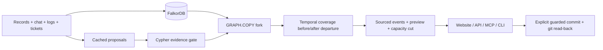

# Baton

**Understand connected company work, investigate its evidence, and leave an actionable next step.**

[Open the deployed company app](https://baton-workspace-2f1no78bu-risehackathonsupport-3406.vercel.app). The Vercel frontend calls AWS Lambda in Mumbai, FalkorDB Cloud Free, and Groq Free. It uses actual FalkorDB public repositories: 28 sampled work items, 21 accounts (including bots), and 18 captured API responses. Public contributors are credited without inferred employment or internal ownership.

The graph agent uses four actual Groq tool calls to inspect work, traverse connected work/files/contributors, open primary evidence, and save a verification task. The final browser run passed with exact source and graph-file checks, persisted provider receipts, and independent task read-back. Semantic entailment is not automatically verified.

Direct integrations also passed: [Jira KAN-1](https://rhudhresh3697.atlassian.net/browse/KAN-1) and a task in Raptorflow's dedicated `#baton-demo` channel. Both were separately read back and graph-linked; repeated publish calls reused the same artifacts. These are the user's integration workspaces, not FalkorDB's internal Jira or Slack. Jira's scoped token expires October 25, 2026. [Deployment evidence and limits](docs/CLOUD_SETUP.md).

The older departure and Acme benchmark companies are synthetic fixtures. Their extraction caches and scripted parser are explicitly labeled and are not evidence of live Groq inference. Acme from Liz Zhang's agent-memory-bench remains at `/benchmark.html`; the Halden fixture is isolated at `/sandbox.html`.

## Start

Requires Docker Desktop with Linux containers, or Docker Engine and Compose on Linux:

```powershell
docker compose up -d --build
```

Open [Baton](http://127.0.0.1:8000), [API docs](http://127.0.0.1:8000/docs) or [FalkorDB Browser](http://127.0.0.1:3000). Ports bind to this computer only. Data persists in named volumes; `docker compose down` stops services without erasing it.

The default workspace requires an authenticated real GitHub import. The deployed Lambda uses request-scoped Groq inference and DynamoDB for sessions and locks; no persistent worker or local model is needed. The original four fixture scenarios (7, 101, 202 and 303) remain in [Departure analysis](http://127.0.0.1:8000/rehearsal.html). Saving fixture ownership changes the live fixture graph and commits `OWNERS.d/<graph>.yaml` in the operations repository. Capacity suggestions respect skills and capacity; manually selected assignments are checked for coverage and active successors.

**v0.2:** Explore the live relationship graph, inspect nodes/edges and their sources, use **suggested successors** from the capacity solver, then preview and commit the plan. Saved receipts remain available after reload. See [the end-to-end upgrade](docs/END_TO_END_UPGRADE.md).

**Legacy company fixture:** [Open Halden](http://127.0.0.1:8000/sandbox.html). Meet the team, follow Oaktree's customer promise, inspect the work Hana carries, plan and save a handover, track follow-up tasks and download the brief. See [the company experience](docs/COMPANY_WORKSPACE.md). Halden is a clearly labelled fictional company with working API-backed actions.

**Acme benchmark:** [Open Liz Zhang's benchmark company](http://127.0.0.1:8000/benchmark.html). Replay the original 50-item inbox and run all 25 checkpoint questions against FalkorDB. Uses a labelled deterministic text parser; no model key required. See [benchmark details](docs/ACME_DEMO.md).

**Saving ownership now requires Operator sign in.** Retrieve the local token with `docker compose exec api cat /data/.operator-token`, sign in, preview the exact plan, and confirm successor agreement before saving. Read-only demos remain available. All five red-team findings and the header gap are fixed; see [security fixes and verification](docs/SECURITY_FIXES.md).

## Run the ZIP's tests

```powershell
docker compose --profile checks build checks
docker compose --profile checks run --rm checks
```

Or use `./scripts/test.ps1` on Windows / `sh scripts/test.sh` on Linux. **Historical verification: 172 tests passed:** the 88 unchanged ZIP checks through the original integrity-verifying harness, 22 foundation checks, 39 integration/security tests, and 23 red-team regressions. Each graph-dependent suite starts an isolated engine, leaving the application's graph alone. Results: `loop/last_score.json`, `loop/junit.xml`, `artifacts/foundation-tests.xml`, `artifacts/transport-tests.xml` and `artifacts/redteam-tests.xml`.

Current cloud/agent/company adapter contracts: **139 passed**, plus **22 foundation checks**. The legacy graph/red-team suites could not be rerun on this Windows host because the isolated Redis/FalkorDB engine is unavailable and Docker Desktop is not responding; they are not counted as current passes. The original integrity check passed under WSL (the Windows path-separator check reports false unapproved paths).

The original `checks/locked/**` and `loop/bin/**` are untouched. `loop/config.json` replaces the old author's absolute Python path with a portable command. See [verification](docs/BUILD_REPORT.md).

## CLI

The local virtual environment is ready. For a fresh Python 3.12+ environment:

```powershell
uv venv --python 3.12
uv pip install --python .venv/Scripts/python.exe -e . -r requirements-dev.lock
.\.venv\Scripts\python.exe -m baton generate --seed 7 --out artifacts/seed7
.\.venv\Scripts\python.exe -m baton demo --seed 7 --offline
.\.venv\Scripts\python.exe -m baton extract --world artifacts/seed7 --out artifacts/seed7/beliefs.json --offline
.\.venv\Scripts\python.exe -m baton rehearse --world artifacts/seed7 --beliefs artifacts/seed7/beliefs.json --leaver hana.sharma --lane G --confirm all
.\.venv\Scripts\python.exe -m baton ask --world artifacts/seed7 --beliefs artifacts/seed7/beliefs.json --question "What does Hana Sharma owe?" --offline
```

Use `.venv/bin/python` on Linux/macOS. `python -m baton --help` lists all commands, including handover, cut, commit and benchmark import. `answer_key.json` is generated separately for tests/evaluation; product reasoning never reads it. Times are epoch milliseconds with a fixed simulation clock of 2026-10-23 00:00 UTC. Seed 7 has 9 people, 11 recorded duties, 44 records and 74 events.

## MCP

Run `python -m baton.mcp_server` in an installed project environment. It exposes **rehearse, ask, handover and cut** over stdio; no raw-query tool. Handover is a fork-only preview. Persistent writes use the explicit website/API/CLI commit operation.

Configure your MCP client with the absolute Python executable path, args `["-m", "baton.mcp_server"]`, and this project as working directory, or install the project in that interpreter. Environment: `FALKORDB_HOST=localhost`, `FALKORDB_PORT=6379`, `BATON_OFFLINE=1`. Initialization, tool listing and calls are tested through the actual stdio transport.

## Evaluation

The fresh validation protocol was committed before results. The ZIP's historical results were already known; this is replication/validation, not blind preregistration.

```powershell
docker compose --profile checks run --rm -e FALKORDB_HOST=falkordb checks python -m eval.run --seeds 3000-3029 --scales 1,4,8 --lanes W,R,G,A --out eval/results
```

Start the application first. This generates 360 lane records. The graph lane matched the independent checker on all 90 company/scale combinations **using planted beliefs**. Missing real-model caches are reported as not run; fake models test plumbing only. See the [fresh report](eval/results/report.md) for confidence intervals and limits. No new paid GPT/Claude call was made. Historical model price tables are estimates, not current pricing guarantees.

## Architecture and handoff



Coverage follows time-valid OWNER, ROUTES_TO, SHIFT, ESCALATES_TO and gated HOLDS paths. Fixed queries and graph algorithms decide; the model never writes Cypher. Accepted successors use database-enforced `OWNER.active_key` uniqueness. Source IDs, live fingerprints and actual queries are exposed.

- [Architecture](docs/ARCHITECTURE.md), [module status](docs/PHASES.md), [build report](docs/BUILD_REPORT.md)
- [Deployment and recovery](docs/DEPLOYMENT.md), [reuse](docs/REUSE.md), [input provenance](docs/INPUT_PROVENANCE.md)

## Attribution and limits

The backend reuses the user-supplied snapshot identified there as `980c2e2`; it is not claimed as newly authored code. New work includes the website, MCP adapter, API validation, portable deployment/tests, concurrency guards, retry receipts and packaging. Original material remains under `reference/`.

Extraction/cache/provider/fake-model and evaluation patterns adapt [agent-memory-bench by Liz Zhang](https://github.com/zhang-liz/agent-memory-bench), copyright 2026 Liz Zhang, MIT; its vendored world and full notice remain under `third_party/amb/`. The [FalkorDB client](https://github.com/FalkorDB/falkordb-py) and [official MCP SDK](https://github.com/modelcontextprotocol/python-sdk) are MIT dependencies. No competitor hackathon code was used. Codex assisted with architecture, implementation and verification.

The interactive graph uses [Cytoscape.js 3.34.4](https://github.com/cytoscape/cytoscape.js/tree/v3.34.4), MIT, vendored with its full license and provenance manifest under `web/vendor/cytoscape/`.

Synthetic corroboration is not independent real-world truth. Only scheduled work is checked. Public writes require operator authentication, exact-origin checks and bounded requests; read-only public repository records are visible without sign-in. Graph and repository writes are separate systems: external failures are retryable, but an abrupt crash between the graph write and first journal persistence remains a recovery gap. Paid-model validation, direct Jira/Slack integration and event submission are not claimed as completed. The new public workspace has separate cloud evidence linked above.
