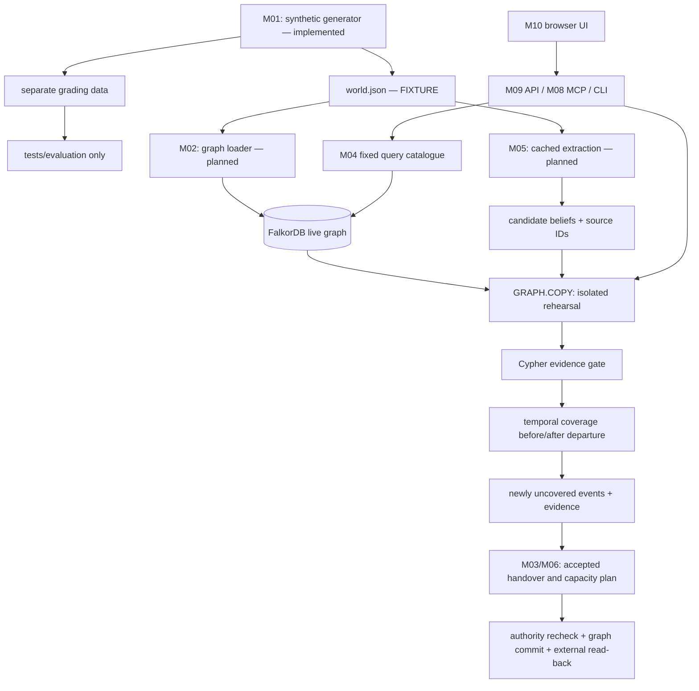

# Baton architecture

## Product boundary

Baton connects company records and informal evidence to scheduled duties. Its defining operation is: compare coverage before and after a person's departure, at each event's time, and explain any newly uncovered event with sources.

The user subsequently authorized the full build. The architecture below records the original component plan; M01–M10 now run locally, with Docker deployment and handoff artifacts. See BUILD_REPORT.md for current evidence and PHASES.md for public-hosting/submission boundaries. The independent Python checker belongs exclusively to tests and evaluation.

## Components and ownership

| Component | Responsibility | Boundary |
|---|---|---|
| `baton/generate.py` (implemented) | Seeded company data and separate grading material | Standard library only; fixed clock; no network |
| `baton/__main__.py` (implemented) | CLI parsing and one JSON summary | Exposes `generate` only |
| graph/load (planned M02) | Connection, graph naming, indexes, import and fork lifecycle | Parameterized writes; fail visibly if graph unavailable |
| rehearsal (planned M02) | Gate, graph paths, live/fork coverage comparison and provenance | Reads event clock from graph; never uses grading material |
| handover (planned M03) | Validate and accept successor plan, simulate replay | Make successor effective before retiring previous accountability |
| ask (planned M04) | Select known tool, run fixed query, format sourced answer | Model may select arguments; it never authors Cypher |
| extraction/LLM (planned M05) | Structured proposals, retries, exact cache replay, usage accounting | Untrusted proposals stay distinct from record facts |
| cut/commit (planned M06) | Capacity feasibility, residual cut, authority-checked commit and receipts | External repository write has separate failure/recovery state |
| eval (planned M07) | Independent reference, unseen seeds, fair baseline and intervals | Never imported by product runtime |
| MCP/API/UI (planned M08–10) | Transport and presentation over shared operations | No independent browser reasoning or silent mock answers |

Start with one Python package and explicit functions. Avoid introducing queues, a second database or a separate service per module before a measured need. The supplied CLI-subprocess API is a compatibility starting point; any later direct-function adapter must preserve the same validated input/output contracts.

## Phase-one data contract

`build(seed, scale=1)` returns `(world, grading_data)` in memory. The CLI writes deterministic UTF-8 JSON with sorted keys and LF newlines. A summary names the intended future graph without connecting to one. Seed and scale determine all choices; the real clock is never used.

World fields: `seed`, `label`, `company`, `now`, `day_ms`, `window_days`, `leaver`, `leave_at`, and the lists `people`, `duties`, `records`, `events`, `messages`, `joblogs`, `tickets`. Scaled worlds also contain `scale` and `units`. The fixed `now` is 1792713600000 ms; departure is one day later; the default analysis window is 30 days.

People include `id`, `name`, `team`, `role`, `left_at` and `capacity`. Records include `OWNER`, `ROUTES_TO`, `SHIFT`, `ESCALATES_TO` and `CAN`. `CAN` says who has a skill; it is not ownership. Events have an ID, duty ID, epoch-ms `at` and label. Evidence rows have stable IDs, author/actor and source-specific content. IDs are assigned after sorting; changing generator templates can renumber evidence references, so preserve compatibility or regenerate dependent caches together in a later phase.

The world contains schedules, historical job statuses and evidence, not expected departure-failure results. Grading data contains true/noise candidate beliefs and is written separately. True beliefs can introduce duties and events absent from the recorded duty catalogue.

## Planned graph model

| Node or edge | Meaning |
|---|---|
| `Company` | Fixture identity, seed, window and simulation clock |
| `Person` | Identity, team/role, departure time and capacity |
| `Duty`, `Rota`, `Event` | Work obligation, on-call schedule and scheduled occurrence |
| `Source` | Original message, job log, ticket or record, with provenance ID |
| `Duty -OWNER-> Person` | Recorded owner |
| `Duty -ROUTES_TO-> Rota -SHIFT-> Person` | Time-bounded on-call path |
| `Person -ESCALATES_TO-> Person` | Escalation route, including through departed intermediates |
| `Event -NEEDS-> Duty` | Event requires coverage for this duty |
| `Belief -CITES-> Source` | Proposed claim linked to existing evidence |
| `Duty -HOLDS-> Person` | Evidence-gated informal responsibility on the fork |
| `Person -CAN-> Duty` | Skill eligibility for capacity planning; no implied accountability |
| `Duty -OWNER {basis: 'accepted', active_key}-> Person` | Accepted successor accountability, subject to active-owner uniqueness |

The supplied loader/handover implementation uses the directions above. Some older pack documents name an `ACCOUNTABLE_FOR` relationship; the snapshot instead constrains `OWNER.active_key`. Use the snapshot's accepted OWNER form as the compatibility target and verify it live in M03. Coverage edges use integer epoch-ms `vf` and `vt`, with `vf <= event.at < vt`. Open end is 253402300799000. The terminal person must still be active at that time. A departed intermediate can still route escalation to an active terminal. The initial path bound is four hops, matching the supplied contract.

Create ID lookup indexes and event-time indexes before checking query plans. The planned engine pin is `falkordb/falkordb:v4.22.1`, matching the pack and an existing upstream release. No engine has been run for this phase. Revalidate GRAPH.COPY, algorithm signatures, indexes and uniqueness behavior in M02 before relying on pack claims; do not silently replace this engine with a newer incompatible one.

## Planned rehearsal transaction boundary

1. Read simulation clock and validate the person in the live graph. Fingerprint nodes and edges.
2. Create a uniquely named request fork with GRAPH.COPY. Avoid sharing fixed fork names between requests.
3. Load candidate beliefs and CITES edges in the fork. Promote only if every reference exists, at least two sources are cited, and at least two source types are present.
4. Calculate covered `(duty, event time)` pairs before departure using a fixed query catalogue.
5. Set the leaver's `left_at` in the fork; calculate coverage again.
6. Return events covered before but uncovered after, together with the sources of the original paths. Preserve record/believed/confirmed distinctions.
7. Delete the fork in `finally`; verify the live fingerprint is unchanged.

W uses direct recorded ownership; R adds rota and escalation paths; G adds gated beliefs. All lanes use the same company and time window. The gate provides corroboration across source types, not proof that a claim is true or independent in the real world. Synthetic sources all originate from the generator.

A live fingerprint comparison is a rehearsal integrity check, not a concurrency control mechanism. Later phases must define graph/request locks or snapshot-version checks for imports and commits; independent live writes would otherwise make the comparison ambiguous.

## Planned action and capacity path

Keep successor planning on a fork until acceptance. Reject missing, departed or ineligible successors. Recheck eligibility inside the same graph query that writes accepted ownership; create the required relationship index before the active-owner UNIQUE constraint. Verify replay and record a receipt. The supplied guarded query checks existence, active status and exclusion of the leaver; this is not user authentication or organizational authorization. Real user permissions and explicit capacity enforcement at commit time require additional design in the action phase.

For feasibility, create a capacity network: source to uncovered duties, duties to eligible people, people to sink with their spare capacities. FalkorDB maxFlow supplies flow; a residual BFS derives a min-cut if the engine does not return it. Explain a shortfall instead of silently overassigning staff.

The graph commit and git/Gitea write are separate systems. They are not an atomic distributed transaction. Use a stable operation ID, idempotent retries, explicit graph-committed/external-pending/verified receipt states, and read back the target file. On an external write failure, report partial completion and permit recovery without duplicating the graph action.

## Planned adapters and deployment

Preserve `/api/health`, demo, handover, ask, cut, commit and catalogue contracts from the supplied API when those phases are authorized. Exact request/response fixtures are under `reference/Baton_build_pack/modules/M10_web/samples/`. Validate request types and bounds, distinguish graph unavailable from invalid input, and prevent a frontend question from triggering an unexpected paid model call.

The browser presents month lanes, evidence, successor selection and sourced Ask answers. Recorded replay must be explicitly labelled and must not accept actions as if it were live. MCP exposes the same domain functions through typed tools.

The pack proposes EC2 Docker for graph/API and Vercel for static assets. Before deployment, resolve HTTPS upstream routing and keep database ports private; do not simply forward a public HTTPS frontend to an unprotected public HTTP backend. No cloud resources, containers or credentials are provisioned in phase one.

## Evidence and limits

Phase one proves deterministic fixture generation and contract compatibility. It does not prove live graph queries, departure results, safe commits, extraction accuracy, deployment readiness or the ZIP's evaluation claims. Later phase gates must produce fresh evidence. Event rules and deadlines quoted in the pack are historical source claims; no submission action is authorized here.
