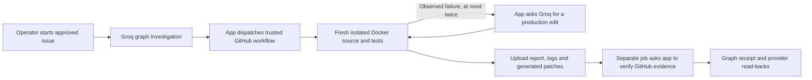

# App-triggered engineering workflow

The [cloud workflow workbench](https://baton-workspace.vercel.app/#workflow-runner) starts a new GitHub Actions execution from the app. Its evidence is separate from the older, imported [Codex Docker verification](evidence/KAN-2.md). A saved task, successful model response, accepted dispatch or historical passing receipt does not establish that a new cloud run passed. Read the individual run's job, logs, proposed changes and destination read-backs.

## Reviewed scope

This is one approved engineering profile, not an arbitrary repository agent:

| Input | Fixed value |
| --- | --- |
| Public source | `FalkorDB/FalkorDB`, issue `#3246`, grow-only tensor resize / restore |
| Source commit | `d8190da5a99b4207e847e2fa2547911d96bd9e61` |
| Build image | `ghcr.io/falkordb/falkordb-build@sha256:b5d954ebaf523da2171bb6306c9348a767963f32e0e1f0a3b1115a66f1e397a7` |
| Model-editable path | `graph/src/runtime/ops/batched_result_emitter.rs`, production region only |
| Protected tests | Entire suffix beginning with the first exact `#[cfg(test)]` marker; every other tracked file must match the pinned commit |
| Destinations | Existing Jira `KAN-2` and its original Raptorflow Slack message |

The editable constructor file is the separately observed failure from the earlier library run. It is not a claim that this constructor is the tensor bug. A fresh cloud run must observe its own failure before requesting a repair. If the original suite passes, the worker records `passed_no_fix` and makes no repair call. The unchanged tensor/restore regressions still run.

Jira KAN and Raptorflow Slack are the user's connected workspaces. They are not represented as FalkorDB's internal systems. No upstream issue closure, repository write, pull request, merge or production deployment is performed by this profile.

## What a click authorizes

An authenticated operator starts `POST /api/public/workflows` with the approved item, bounded repair enabled and Jira/Slack targets. Anonymous users can read progress and verified evidence; they cannot dispatch a job. Starting the workflow authorizes the selected code checks, at most two model repairs and the corresponding updates to the existing connected artifacts.



The graph investigation must first succeed through the existing work-item, connection and primary-source tools and save its source-backed task. The app then dispatches the repository's reviewed `baton-execute.yml` workflow on `main`, recording the expected workflow commit. It does not run Rust inside Lambda or the browser.

The GitHub `execute` job checks out the trusted worker with checkout credentials disabled afterward. The worker pulls the pinned public image and fetches the pinned public upstream commit into a fresh container. It verifies all 957 tracked blobs, records Rust/Cargo versions and source hashes, and uses the image's keyed native dependency archives under `/opt/falkordb-deps`. Optional caching contains public Cargo registry/git downloads only; local checkouts, compiled `target` directories and historical result artifacts are not runner inputs.

The callback capability stays in the trusted GitHub host process. The source container receives only the explicit build settings (`CARGO_BUILD_JOBS=2`, `CARGO_PROFILE_RELEASE_LTO=false`), has no host mounts or Docker socket, and runs with dropped capabilities, no-new-privileges, two CPUs, a 6 GiB memory limit and a PID limit. The app stores a digest of the per-run capability with a two-hour lifetime. A callback token alone is insufficient to claim completion: the app also checks the GitHub run and artifact.

## Failure-driven repair and verification

The worker first runs the unmodified debug graph library. It sends a failed command receipt, bounded log tail, production source and immutable test-region hash to the app's `/repair` callback only after an actual failing command. Groq returns one exact old/new production substring edit. The app binds the submitted source to the pinned original plus any prior recorded edits, constructs a unified diff mechanically and records the model response and measured token receipt. There is no stored clamp patch in this execution path.

The worker checks the returned diff's hash, model receipt, single approved file, edit size and forbidden test/build-condition or unsafe-code changes before applying it. It verifies the original test bytes and the other tracked source files after application and after checks. Generated patches that fail validation or application remain in the artifact as unapplied attempts; unknown test integrity is never marked verified. Two unsuccessful repair attempts stop execution. Infrastructure, model, timeout and validation failures do not substitute a passing result.

Required successful checks are:

| Check name | Actual command or required result |
| --- | --- |
| `graph_library_initial`, or latest `graph_library_repair_1/2` | `cargo test --locked -p graph --lib -- --test-threads=1`; exactly 530 passed, 0 failed, 17 ignored, with 547 tests enumerated |
| `debug_resize` | Exact `graph::graphblas::tensor::tests::resize_asserts_it_never_shrinks`; 1 passed |
| `debug_restore` | Exact `graph::graph::restore_tests::restore_never_shrinks_the_saved_matrices`; 1 passed |
| `release_resize` | Exact `graph::graphblas::tensor::tests::resize_never_shrinks` under `--release`; 1 passed |
| `release_restore` | Exact restore test under `--release`; 1 passed |
| `format` | `cargo fmt --all --check`; exit 0 |

The targeted commands include `--exact --nocapture --test-threads=1`. Zero selected tests, changed profiles, unrelated commands and mismatched totals cannot satisfy these gates. Historical failed library checks remain visible; the final library attempt and all four target checks plus formatting determine the successful result. The four repeated target passes add to the library's 530 for the app's aggregate **534 recorded test passes**, not 534 distinct tests. The 17 ignored upstream benchmarks/probes are not run or counted as passed. Only the two named regression cases run in release mode; there is no claim of a full release suite.

**RDB save/reload is not executed by this cloud profile.** The earlier Codex receipt's two RDB cycles are historical evidence with a different executor and run. They must not be attached as results of a new GitHub Actions run. This profile does not make a new matrix-dimension, persistence-integration or performance claim.

## Why a runner callback is not proof

The `execute` job always attempts to upload `report.json`, raw check logs and generated patches using the pinned `actions/upload-artifact` action. Artifacts are retained by GitHub for one day. A separate dependent `finalization` job runs after `execute` has completed and calls `/complete` with the run ID and artifact name.

Before accepting completion, the app independently checks:

- The GitHub repository, `workflow_dispatch` event, first run attempt, workflow path, expected head commit and execution-specific run title.
- A completed `execute` job and its conclusion; the finalization job is a separate job and cannot stand in for the execute job.
- One unexpired artifact belonging to that exact run, with matching artifact digest when supplied by GitHub.
- Safe archive paths, exact command arguments, raw log lengths and hashes, parsed test totals, repair ordering and byte-for-byte agreement with the recorded Groq patches and provider receipts.
- Required final tests, unchanged test-region hash and the approved source scope before publishing success.

The app preserves the verified artifact contents and report hash in its own storage and exposes evidence/log reads. It then writes the run's graph receipt and verifies graph read-back. Provider updates have durable write intents and independent read-backs: the existing Jira issue receives the run evidence and a verified transition when appropriate, while the original Slack message receives the verified outcome. Failed verified executions can be reported as failures; they do not authorize task completion. A provider or graph failure leaves a failed/partial state rather than a completed one. Uncertain external writes are not blindly retried.

These checks establish provenance and measured behavior for this reviewed runner. They are not a formal proof of patch correctness or a cryptographic remote-compute attestation. The workflow repository and its operators remain trusted inputs. A generated patch remains a local runner change; passing tests do not merge it upstream.

## Bounded use of existing services

The worker has a 35-minute wall-clock deadline and a 20-minute limit per code-check command. The GitHub execute job has a 40-minute timeout, followed by a separately bounded five-minute finalization job. One workflow runs at a time. The app allows at most ten attempted starts per UTC month and two repair attempts per run, with a separate daily repair-call allowance. Failures can consume an attempted-start allowance.

No new paid compute service is provisioned. The private repository uses standard GitHub-hosted Linux runners against the repository owner's **shared included Actions allowance**. GitHub currently lists 2,000 monthly minutes and 500 MB artifact storage for GitHub Free; other workflows and storage also consume that allowance. Ten maximum-duration execute jobs could consume up to 400 minutes, plus up to 50 finalization minutes. This is a workload bound, not a guarantee of free remaining capacity or a billing guard for the whole account. Existing paid-account settings can permit charges beyond included usage; operators must check their account's actual allowance and spending settings. [GitHub Actions billing](https://docs.github.com/en/billing/concepts/product-billing/github-actions).

The selected private-repository `ubuntu-24.04` standard runner is currently documented as two CPUs, 8 GB RAM and 14 GB SSD. The application uses the smaller explicit container limit described above. [GitHub-hosted runner specifications](https://docs.github.com/en/actions/reference/runners/github-hosted-runners).

## Reproduce the application contract checks

```text
docker compose --profile checks build checks
docker compose --profile checks run --rm checks
```

`scripts/check_all.py` preserves the original scoring command and reports the autonomous worker, repair, route, verifier, publisher and actual JavaScript UI checks as a separate suite. `deploy/Dockerfile.checks` installs Node.js alongside Python and Git so the UI tests execute instead of silently skipping. These are application contract tests with mocked provider boundaries; they do not constitute a live GitHub, Groq, Jira or Slack execution. Live claims require the corresponding app run and its independently verified evidence.
